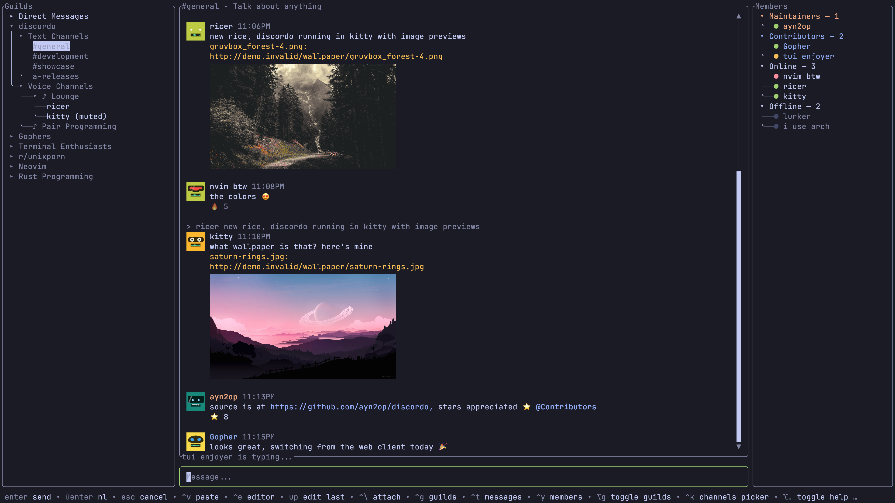
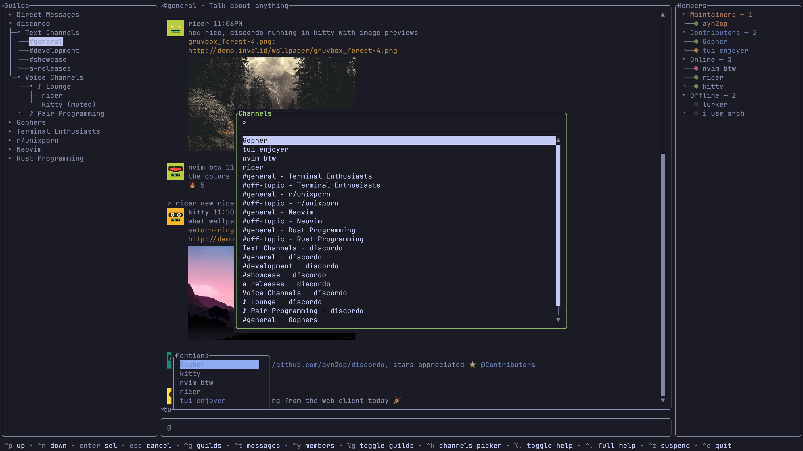

# MichalTerm

> **Your conversations. Your terminal.**

MichalTerm is a fast, lightweight, and modern terminal-based Discord client crafted for Linux enthusiasts, particularly on Arch Linux and Omarchy Linux with Hyprland.

Designed with a keyboard-first workflow and a refined dark theme with subtle green accents, MichalTerm lets you chat, manage channels, browse servers, and listen to voice channels without leaving your terminal.




## Highlights

- **Lightweight & Fast**: Built in Go using a high-performance terminal UI.
- **Omarchy & Hyprland Ready**: Keyboard-centric design, responsive layout adaptation, and clean contrast with subtle green accents.
- **Rich Feature Set**: Servers (guilds), text & voice channels, markdown formatting, autocomplete mentions, reactions, and attachments.
- **Flexible Authentication**: Log in via QR code, password, token prompt, or environment variable.
- **Backward-Compatible Migration**: Smoothly falls back to and migrates configuration and stored tokens from existing Discordo installations.

## Installation

### Building from Source

Requires [Go](https://go.dev/dl) (version 1.27+). On Linux, voice support optionally requires a C compiler and `libpulse` or `libasound` (PulseAudio / ALSA).

```sh
# Clone repository
git clone https://github.com/Michal-Nithesh/MichalTerm.git
cd MichalTerm

# Build executable
go build -o michalterm .

# Optional: Install to your local bin path
install -Dm755 michalterm ~/.local/bin/michalterm
```

#### Build Tags

- `-tags no_voice`: Build without voice audio dependencies.
- `-tags no_spoof_tls_fingerprint`: Build without TLS fingerprint spoofing.

## Usage

Start MichalTerm simply by running:

```sh
michalterm
```

### Command Line Options

```text
MichalTerm - Your conversations. Your terminal.

Usage:
  michalterm [options]

Options:
  -config-path string
        path of the configuration file (default: ~/.config/michalterm/config.toml)
  -log-level string
        log level (debug, info, warn, error) (default "info")
  -log-path string
        path of the log file (default: ~/.cache/michalterm/logs.txt)
  -version
        print version and exit
```

### Authentication Methods

1. **QR Code (Recommended for mobile users)**:
   - Run `michalterm`.
   - Select the **QR** tab and scan the code using the Discord mobile app.
2. **Token (UI)**:
   - Run `michalterm`.
   - Select the **Token** tab, enter your token, and click Login (the token is securely stored in your system keyring).
3. **Password**:
   - Run `michalterm`.
   - Enter your email/phone and password in the **Password** tab.
4. **Environment Variable**:
   - Set `MICHALTERM_TOKEN` (or legacy `DISCORDO_TOKEN`):

```sh
export MICHALTERM_TOKEN="your_discord_token_here"
michalterm
```

## Configuration

MichalTerm loads its configuration from:

- **Linux / Unix**: `$XDG_CONFIG_HOME/michalterm/config.toml` or `~/.config/michalterm/config.toml`
- **Darwin (macOS)**: `~/Library/Application Support/michalterm/config.toml`
- **Windows**: `%AppData%/michalterm/config.toml`

### Migration & Fallback

If no configuration file exists at `~/.config/michalterm/config.toml`, MichalTerm will automatically check for and fall back to your existing `~/.config/discordo/config.toml`. Similarly, saved authentication tokens in your system keyring will automatically be migrated from `discordo` to `michalterm`.

For all configurable options, themes, keybindings, and layout settings, see the [Configuration Reference](./docs/config.md).

## Logs

Logs are written to:

- **Linux / Unix**: `$XDG_CACHE_HOME/michalterm/logs.txt` or `~/.cache/michalterm/logs.txt`
- **Darwin (macOS)**: `~/Library/Caches/michalterm/logs.txt`
- **Windows**: `%LocalAppData%/michalterm/logs.txt`

## License & Attribution

MichalTerm is open-source software licensed under the **GNU General Public License v3.0 (GPL-3.0)**.
See the [LICENSE](./LICENSE) file for complete details.

### Attribution

MichalTerm is based on and derived from [Discordo](https://github.com/ayn2op/discordo), originally authored by **ayn2op**:
- Copyright (C) 2025-present ayn2op
- Copyright (C) 2026 Michal Nithesh and MichalTerm contributors

All original notices, license grants, and architectural foundations are preserved in accordance with the GNU General Public License v3.0.

## Disclaimer

> [!IMPORTANT]
> Using automated user accounts ("self-bots") or third-party clients may be against Discord's Terms of Service. MichalTerm does not automate normal user account actions and connects as an interactive terminal client. Use responsibly and at your own discretion.
